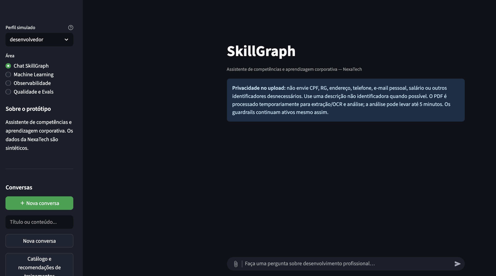

# 🧠 SkillGraph

> Projeto acadêmico em desenvolvimento na disciplina **AI Factory: Building Intelligent Systems**, do curso de Inteligência Artificial da **PUCPR (2026)**.
>
> Orientação: **Professor Wellington Rodrigo Monteiro**
> Desenvolvimento: **Bárbara Jaeger Specian**, com assistência de Inteligência Artificial.

## 🎯 O que é o SkillGraph?

O **SkillGraph** é um assistente de competências e aprendizagem corporativa para a NexaTech, uma empresa fictícia de tecnologia e serviços. O projeto combina documentos, dados estruturados, modelos locais de linguagem, Machine Learning e agentes especializados para apoiar conversas de desenvolvimento profissional em Recursos Humanos.

O sistema ajuda a:

- consultar políticas, cargos, trilhas e treinamentos;
- identificar lacunas agregadas de competências;
- recomendar trilhas técnicas para um colaborador descrito sem PII;
- sugerir treinamentos e pré-requisitos;
- analisar currículos em PDF com foco em extrair competências e senioridade;
- explicar as evidências e limitações das recomendações;
- acompanhar rotas, agentes, ferramentas, latência e erros;
- avaliar o comportamento do sistema com Golden Dataset e DeepEval.

Os dados da NexaTech são sintéticos. O SkillGraph é um protótipo acadêmico e **não substitui avaliação humana, autenticação corporativa, decisões de RH ou políticas reais de privacidade**.

### Interface do SkillGraph via Streamlit



## 🧩 Desenvolvimento faseado: um único sistema integrado

A Etapa 1 construiu a fundação conversacional e de segurança:

- Interface Streamlit com histórico, perfis simulados e feedback;
- Roteador determinístico de intenções;
- RAG com Chatflow Dify e armazenamento vetorial Weaviate;
- Consultas read-only em DuckDB sobre CSVs relacionais;
- Fontes recuperadas, tabelas, indicadores e gráficos;
- Guardrails contra PII, prompt injection e SQL destrutivo.

Para conhecer em detalhes o desenvolvimento da Etapa 1, consulte a [documentação completa da Etapa 1](docs/documentacao-completa-etapa1.md).

A Etapa 2 amplia essa fundação sem substituí-la:

- Machine Learning tradicional com O*NET 31.0, FLAML e artefato PKL;
- Recomendação de trilhas, prioridades, incerteza e explicabilidade;
- Sistema multiagente com CrewAI e LM Studio;
- Agentes especializados com ferramentas allowlisted;
- Análise de currículo com PyMuPDF, OCR local e JEV opcional;
- Observabilidade local e integração opcional com Langfuse;
- Golden Dataset, testes automatizados e DeepEval como LLM-as-a-judge.

O [relatório técnico da Etapa 2](docs/evaluation-etapa2.md) apresenta o dataset, as métricas, os agentes, a observabilidade e os resultados da avaliação.

🎥 [Assistir ao vídeo de demonstração da Etapa 2 no YouTube](https://youtu.be/2MAOLrRoTvI)

Para saber como a Etapa 2 foi desenvolvida e integrada tecnicamente, consulte a [documentação completa da Etapa 2](docs/documentacao-completa-etapa2.md).


Em conjunto, o SkillGraph encaminha cada solicitação para a camada mais adequada: documentos, dados estruturados, Machine Learning ou uma rota multiagente. As duas etapas formam um único produto integrado.

## 🔄 Como uma pergunta percorre o sistema

```text
Usuário
  ↓
Streamlit: chat, histórico, perfis e upload de PDF
  ↓
Guardrails: PII, prompt injection, escopo e operações inseguras
  ↓
Roteador de intenção
  ├── RAG documental → Dify → Weaviate → LM Studio → resposta + fontes
  ├── Dados estruturados → funções read-only → DuckDB → tabela/indicador
  ├── Machine Learning → LM Studio interpreta → backend valida → PKL/XAI → trilhas
  ├── CrewAI → Core Router Agent → agente especialista → ferramenta necessária → Reviewer Agent → Synthesizer Agent
  └── Solicitação sensível → bloqueio antes de modelo ou banco
 ↓
Resposta ao usuário
```

## 🏗️ Arquitetura e responsabilidades

| Camada | Responsabilidade |
|---|---|
| Streamlit | Interface, histórico, perfis simulados, upload, respostas, tabelas, gráficos e painéis técnicos. |
| Guardrails | Bloqueio de PII, prompt injection, decisões laborais e operações SQL inseguras. |
| Roteador | Seleção determinística da intenção e da rota apropriada. |
| Dify + Weaviate | RAG documental, recuperação de contexto, Chatflow e fontes. |
| DuckDB | Consultas agregadas e read-only nos CSVs relacionais sintéticos. |
| LM Studio | Modelo local de chat, interpretação ML, síntese e suporte ao CrewAI. |
| ML/FLAML/PKL | Recomendação de trilhas e prioridades de competências. |
| CrewAI | Orquestração de agentes por rota e handoffs estruturados. |
| JEV | Integração opcional para sinais estruturados de currículo sanitizado. |
| Langfuse | Tracing externo sanitizado e distribuído. |
| Golden dataset/DeepEval | Testes automatizados e avaliação semântica de respostas. |

### Sistema multiagente

O CrewAI não fornece o LLM; ele orquestra o modelo local do LM Studio. Os agentes são selecionados por rota e não formam uma cadeia fixa para todas as perguntas:

| Agente | Papel | Ferramenta |
|---|---|---|
| Core Router | Classificar intenção e escolher rota | Nenhuma |
| Resume Interpreter | Interpretar currículo sanitizado | OCR/PyMuPDF + JEV via backend |
| Profile Normalizer | Normalizar competências e remover PII | Nenhuma |
| Prediction Specialist | Executar recomendação de trilhas | `CompetencyRecommendationTool` / PKL |
| Gap Analyst | Interpretar lacunas | Estado estruturado |
| Learning Path & Training Recommendation Agent | Consultar treinamentos e pré-requisitos | `TrainingCatalogTool` / DuckDB |
| Policy Specialist | Consultar políticas com fontes | `DifyPolicyTool` / Dify |
| Structured Data Specialist | Consultar lacunas e indicadores agregados | `CompetencyGapTool` / DuckDB |
| Safety Reviewer | Validar segurança, schema e evidências | Nenhuma |
| Response Synthesizer | Redigir a resposta final | Nenhuma |

O painel **Raciocínio estruturado do agente** na resposta ao usuário, mostra somente resumos públicos dos agentes realmente usados, suas funções e ferramentas. Não exibe chain-of-thought ou prompts privados.

## 🚀 Como executar em uma máquina nova

### Pré-requisitos

- Docker Desktop com Docker Compose v2;
- Python 3.11.x;
- Git e `curl`;
- LM Studio com modelo de chat carregado;
- modelo de embeddings compatível com `/v1/embeddings`;
- memória e espaço para o modelo local e os containers Dify.

Verifique as ferramentas:

```bash
docker --version
docker compose version
git --version
python3 --version
```

### 1. Configuração local

```bash
cp env.example .env
```

O `.env` é ignorado pelo Git e nunca deve ser publicado. Para ativar a Etapa 2 multiagente:

```env
CREWAI_ENABLED=true
```

Para habilitar o tracing externo, use as três variáveis fornecidas pelo Langfuse e a flag da aplicação:

```env
LANGFUSE_ENABLED=true
LANGFUSE_PUBLIC_KEY=...
LANGFUSE_SECRET_KEY=...
LANGFUSE_BASE_URL=https://...
```

### 2. LM Studio

Inicie o servidor local na porta `1234` e confirme os IDs expostos:

```bash
make check
make test
```

O modelo de chat e o modelo de embeddings são responsabilidades diferentes. O primeiro gera respostas; o segundo transforma documentos e perguntas em vetores.

### 3. Dify

```bash
make bootstrap
make up
make smoke
```

Acesse `http://localhost/install`, configure o provider LM Studio, cadastre chat e embeddings e publique o Chatflow. Consulte [docs/model-setup.md](docs/model-setup.md).

### 4. Dependências e Machine Learning

```bash
make bootstrap-crewai
make bootstrap-flaml
make train-ml
```

O treinamento gera o artefato local `.ml_artifacts/skillgraph_competency_tracks.pkl`.

### 5. Executar

```bash
CREWAI_ENABLED=true make run
```

A aplicação ficará em `http://localhost:8501`.

## 📚 Fluxos para experimentar

### RAG legado

```text
Qual é a carga horária de um cargo sênior?
```

Fluxo: roteador legado → Dify/Weaviate → resposta com fonte.

### Dados estruturados e CrewAI

```text
Quais competências têm mais lacunas?
```

Com CrewAI habilitado: Core Router → Structured Data Specialist → `CompetencyGapTool` → Safety Reviewer → Response Synthesizer.

### Treinamentos e CrewAI

```text
Quais treinamentos devo priorizar para um colaborador com lacuna em Python?
```

Fluxo: Core Router → Learning Path Agent → `TrainingCatalogTool` → Reviewer → Synthesizer.

### Política e CrewAI

```text
Quais regras de reembolso se aplicam a este treinamento?
```

Fluxo: Core Router → Policy Specialist → `DifyPolicyTool` → Reviewer → Synthesizer.

### Currículo e JEV opcional

Envie um PDF sintético com:

```text
Analise este currículo para desenvolvimento profissional.
```

Fluxo: PDF → PyMuPDF/OCR → sanitização → JEV opcional → Resume Interpreter → Profile Normalizer → Reviewer → Synthesizer.

### Machine Learning

```text
O colaborador da equipe de dados tem Python avançado, SQL intermediário e está começando em IA generativa. Qual trilha priorizar?
```

Use a área **Machine Learning** para visualizar trilhas, prioridades, incerteza e explicabilidade.

## 📊 Observabilidade e avaliação

O perfil Desenvolvedor possui a funcionalidade principal de chat e as funcionalidades:

- **Machine Learning:** métricas, cobertura, incerteza e XAI;
- **Observabilidade:** traces locais, rotas, spans, latência, tokens, custos, serviços e erros;
- **Qualidade e Evals:** Golden Dataset e relatórios DeepEval.

O Golden Dataset principal possui 25 casos. `evals/rag_goldens.jsonl` possui 12 casos com resposta, contexto e ground truth para o runner live. O DeepEval mede Faithfulness, Answer Relevancy, Contextual Precision e Contextual Recall. A última execução registrada avaliou 12 casos, com médias 0,9514, 0,9236, 1,0000 e 0,8810, respectivamente, e pass rate de 100%; as weaknesses continuam documentadas no relatório técnico.

Execute a avaliação offline com:

```bash
make evaluate-ai
```

Para a avaliação live, que pode consumir tokens:

```bash
.crew-venv/bin/python scripts/evaluate-ai-live.py \
  --deepeval \
  --yes-live \
  --dataset evals/rag_goldens.jsonl \
  --output output/evaluation/live_ai_report.json
```

Para validar a conexão Langfuse sem expor chaves:

```bash
.crew-venv/bin/python scripts/validate-langfuse-connection.py
```

## 🧪 Testes e qualidade de código

```bash
.venv/bin/python -m pytest -q tests
make lint
make ci
```

A suíte cobre roteamento, guardrails, Dify/SSE, DuckDB read-only, ML/PKL/XAI, CrewAI, JEV mockado, PDF/OCR, estado multi-turno, observabilidade, Langfuse sanitizado, dashboard, Golden Dataset e UI.

## 🛡️ Segurança, privacidade e limites

- `.env`, `.dify/`, bancos, logs, modelos e artefatos locais não fazem parte do pacote público;
- chaves do Dify, JEV e Langfuse nunca devem ser commitadas;
- perguntas com PII, prompt injection e SQL destrutivo são bloqueadas;
- DuckDB e ferramentas de agentes são read-only/allowlisted;
- currículo bruto é temporário e sanitizado antes do JEV;
- logs e Langfuse recebem somente metadados agregados;
- perfis são simulações e não há autenticação/RBAC real;
- recomendações ML não são decisões de emprego;
- dados da NexaTech são sintéticos;
- tokens e custos podem não estar disponíveis em providers locais; quando ausentes, o sistema informa '0' ou estima tokens sem inventar custo.

## 📁 Organização do repositório

```text
.
├── app.py                         # interface integrada Streamlit
├── config/                        # referências do Chatflow e perguntas JEV
├── data_bd/                       # CSVs relacionais sintéticos
├── documents_rag/                 # corpus documental
├── docs/                          # documentação e relatório técnico
├── evals/                         # Golden Dataset e casos semânticos
├── scripts/                       # bootstrap, avaliação e diagnóstico
├── src/                           # ML, agentes, RAG, SQL, JEV e observabilidade
├── tests/                         # testes automatizados
├── env.example                    # configuração sem segredos
├── Makefile                       # comandos operacionais
└── requirements.txt               # dependências Python
```

## 🧰 Documentação

- [Documentação completa da Etapa 1](docs/documentacao-completa-etapa1.md)
- [Documentação completa da Etapa 2](docs/documentacao-completa-etapa2.md)
- [Relatório técnico da Etapa 2](docs/evaluation-etapa2.md)
- [Machine Learning tradicional](docs/ml-traditional.md)
- [Integração LLM → PKL](docs/ml-llm-integration.md)
- [Avaliação do modelo ML](docs/evaluation-ml.md)
- [XAI](docs/xai-ml.md)
- [CrewAI e agentes](docs/agents-crewai.md)
- [Fluxos multiagente](docs/agent-flows.md)
- [Configuração Dify/LM Studio](docs/model-setup.md)
- [Observabilidade](docs/observability.md)
- [Avaliação robusta de IA](docs/evaluation-ai.md)
- [Arquitetura RAG](docs/rag-architecture-decisions.md)

## 🔖 Versão e próximos passos

A versão corrente está em [VERSION](VERSION) e as mudanças em [CHANGELOG.md](CHANGELOG.md). O projeto usa Python 3.11 como runtime oficial.

O SkillGraph ainda é um MVP acadêmico. A Etapa 3 pode ampliar o dataset e o corpus, validar as recomendações com especialistas, adicionar autenticação e RBAC reais, formalizar retenção e governança e realizar testes de carga.
