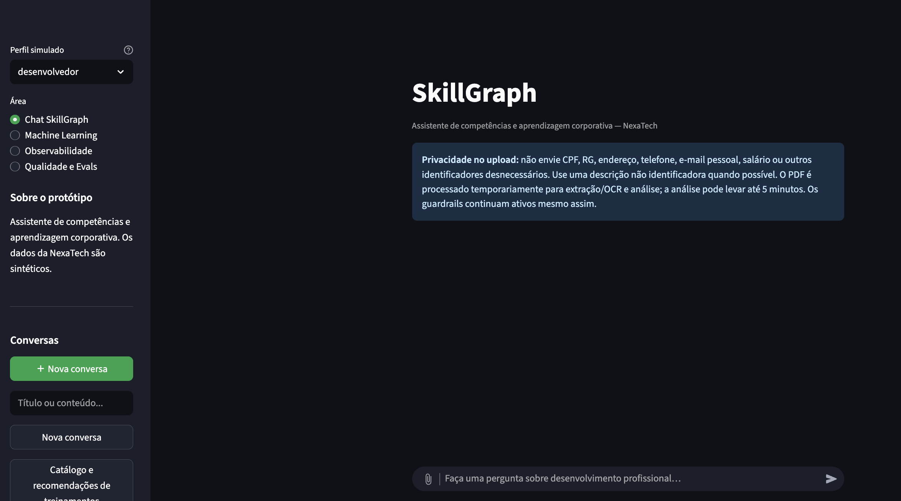

# 🧠 SkillGraph

## Assistente inteligente para competências e aprendizagem corporativa

> Projeto acadêmico desenvolvido na disciplina **AI Factory: Building Intelligent Systems**, do curso de Inteligência Artificial da **PUCPR**.
>
> **Acesso ao protótipo publicado:** [skillgraph-z7dhxolnwrbssdmc79erp9.streamlit.app](https://skillgraph-z7dhxolnwrbssdmc79erp9.streamlit.app/)



O **SkillGraph** é um protótipo de assistente inteligente para apoiar conversas de desenvolvimento profissional na NexaTech, uma empresa fictícia de tecnologia e serviços. Ele combina recuperação de informação, dados estruturados, Machine Learning, agentes especializados e observabilidade em uma única aplicação.

> ⚠️ **Importante:** os dados da NexaTech são sintéticos. O SkillGraph é um protótipo acadêmico e não substitui avaliação humana, autenticação corporativa, decisões de RH ou políticas reais de privacidade.

## 🎯 Problema e objetivos

Em organizações, informações sobre cargos, competências, trilhas, treinamentos e políticas costumam estar espalhadas em documentos e tabelas. Isso dificulta encontrar a fonte correta, comparar requisitos, identificar lacunas e indicar próximos passos de desenvolvimento de um colaborador.

O SkillGraph foi criado para:

- centralizar consultas sobre políticas, cargos, competências, trilhas e treinamentos;
- calcular indicadores agregados em dados estruturados sem permitir SQL destrutivo;
- recomendar trilhas técnicas a partir de um perfil descrito sem dados pessoais;
- indicar prioridades de desenvolvimento, incerteza e competências não reconhecidas;
- analisar currículos em PDF com extração textual e OCR local;
- encaminhar cada pergunta para o agente e a ferramenta mais adequados;
- apresentar fontes recuperadas, raciocínio estruturado público e feedback;
- acompanhar latência, rotas, ferramentas, erros, tokens e custos quando disponíveis;
- avaliar regressões com Golden Dataset e qualidade semântica com DeepEval.

A grande ideia do projeto é tornar a gestão de competências e a aprendizagem corporativa mais orientadas por dados, evidências e inteligência artificial, mantendo transparência, privacidade e revisão humana.

## 🏗️ Arquitetura do sistema

O sistema possui dois contextos operacionais. No desenvolvimento local, o Dify roda em Docker e utiliza o LM Studio para chat e embeddings. No deploy, o Streamlit é publicado na nuvem, o RAG usa Dify Cloud com Weaviate gerenciado e o modelo conversacional utiliza Gemini. As rotas, as ferramentas, os guardrails e os contratos permanecem no código do SkillGraph.


### Como uma pergunta percorre o sistema

1. A interface recebe uma mensagem, um perfil simulado ou um PDF.
2. Os guardrails verificam PII, secrets, prompt injection, toxicidade, escopo e operações inseguras.
3. O roteador determinístico escolhe uma única rota.
4. A rota chama somente a ferramenta autorizada: Dify/RAG, DuckDB, PKL/XAI ou OCR/JEV.
5. O resultado passa por contratos estruturados, revisão e output gate.
6. A resposta é exibida com fontes, tabelas, indicadores, áudio e/ou raciocínio estruturado público, conforme o caso.

## 🧰 Stack detalhada

| Camada | Tecnologias | Responsabilidade |
|---|---|---|
| Interface | Streamlit, pandas | Chat, perfis simulados, histórico, feedback, upload, tabelas, gráficos e painéis técnicos. |
| Roteamento e segurança | Python, roteador determinístico, guardrails, Pydantic, output gate | Seleção da rota, validação de entradas/saídas, bloqueio de PII, secrets, injection, toxicidade e decisões trabalhistas. |
| RAG | Dify Chatflow, Weaviate gerenciado pelo Dify, Gemini em produção, LM Studio local | Recuperação de políticas, cargos, trilhas, treinamentos e FAQs com fontes. |
| Dados estruturados | DuckDB, CSVs sintéticos | Indicadores agregados, catálogo de treinamentos e consultas read-only. |
| Machine Learning | O*NET 31.0, FLAML, scikit-learn, LightGBM via FLAML, joblib/PKL, SHAP | Recomendação exploratória de trilhas, prioridades, incerteza e explicabilidade. |
| Multiagentes | CrewAI, Core Router, especialistas, Safety Reviewer, Response Synthesizer | Handoffs por rota e uso de ferramentas com least privilege. |
| Currículos | PyMuPDF, Tesseract/pytesseract, Pillow, JEV opcional | Extração de texto, OCR e estruturação sanitizada de competências. |
| Modelo LLM local | LM Studio | Chat, embeddings e apoio aos agentes no desenvolvimento local. |
| Modelo LLM produção | Gemini | Chatflow no Dify Cloud, CrewAI e síntese final de respostas elegíveis. |
| Observabilidade | TraceContext, SpanContext, Langfuse Cloud opcional, Slack opcional | Traces sanitizados, latência, erros, tokens, custos e alertas. |
| Avaliação | Golden Dataset, testes automatizados, DeepEval | Regressão de rotas e segurança; avaliação semântica live mediante confirmação. |
| Execução local | Python 3.11, Docker Compose, Dify self-hosted | Ambiente completo de desenvolvimento e testes. |
| Deploy | Streamlit Community Cloud, Secrets | Publicação do app e configuração segura de credenciais. |

## 💬 Perguntas para experimentar

As perguntas abaixo representam fluxos testados ou previstos no projeto. Para perguntas que exigem serviços externos, confirme se Dify, Gemini, CrewAI, o artefato ML e JEV estão configurados.

### Chat - RAG

- **“Quantas horas de treinamento um funcionário sênior deve realizar por ano?”**
- **“Treinamentos online contam para a carga horária anual?”**
- **“Quais são os critérios básicos para participar de treinamentos?”**
- **“Quais competências são recomendadas para um Analista de Dados Júnior?”**

### Chat - Dados estruturados

- **“Quais treinamentos estão disponíveis?”**
- **“Quais treinamentos devo priorizar para um colaborador com lacuna em Python?”**
- **“Qual é a situação da competência COMP003 do funcionário F0001?”**

### Machine Learning

- **“O colaborador da equipe de dados tem Python avançado e SQL intermediário. Qual trilha priorizar?”**
- **“Quais competências o colaborador precisa desenvolver para migrar de software para Machine Learning?”**

### Chat - Análise de Currículo

Envie um PDF sintético e use: **“Analise este currículo para desenvolvimento profissional.”** O fluxo extrai competências, níveis, confiança, evidências e informações ausentes. O PDF é temporário e não deve conter nome, CPF, e-mail, telefone, endereço ou outras informações pessoais reais.

### CHat - Segurança

Também é possível demonstrar bloqueios com tentativas controladas, como pedir CPF, solicitar o system prompt, enviar uma chave de teste ou tentar executar `DELETE`. Essas entradas devem ser bloqueadas antes de chegar a uma ferramenta ou modelo.

## 🚀 Como executar localmente

### Pré-requisitos

- Python **3.11.x**;
- Git e `curl`;
- Docker Desktop com Docker Compose v2;
- LM Studio com um modelo de chat e um modelo de embeddings;
- Tesseract com `por` e/ou `eng` se for testar PDFs escaneados;
- memória e espaço suficientes para os modelos e serviços locais.

Confira as versões:

```bash
python3.11 --version
docker --version
docker compose version
git --version
```

### 1. Baixar o projeto e criar o ambiente

```bash
git clone https://github.com/barbara.specian/skillgraph-proj.git
cd skillgraph-proj
cp env.example .env
python3.11 -m venv .venv
source .venv/bin/activate
python -m pip install --upgrade pip
python -m pip install -r requirements-dev.txt
python -m pip check
```

No Windows PowerShell, ative o ambiente com `\.venv\Scripts\Activate.ps1`.

### 2. Configurar o `.env`

O arquivo [env.example](env.example) contém comentários para cada grupo de configuração. Preencha somente os serviços que pretende usar:

- `DIFY_API_KEY`: chave do Chatflow publicado no Dify;
- `GEMINI_API_KEY`: chave da API Google Gemini usada na produção e na síntese final;
- `LANGFUSE_PUBLIC_KEY`, `LANGFUSE_SECRET_KEY` e `LANGFUSE_BASE_URL`: três valores do projeto Langfuse para tracing externo;
- `TYPESAFE_API_KEY`: somente se a análise de currículo com JEV estiver autorizada;
- chaves de avaliação: somente para o DeepEval live, que pode consumir quota.

Nunca coloque chaves reais no Git ou no navegador. No Streamlit Cloud, use **Settings → Secrets**.

### 3. Preparar o LM Studio

1. Inicie o servidor local na porta `1234`.
2. Carregue um modelo de chat e confirme o ID exposto em `/v1/models`.
3. Configure `LM_STUDIO_CHAT_MODEL` e `LM_STUDIO_EMBEDDING_MODEL` com IDs existentes.
4. Execute:

```bash
make check
make test
```

### 4. Preparar o Dify local

Para executar o ambiente self-hosted de desenvolvimento:

```bash
make bootstrap
make up
make smoke
```

Acesse `http://localhost`, configure o provider LM Studio, envie os quatro documentos de `documents_rag/`, crie a Knowledge Base, publique o Chatflow e configure `DIFY_API_BASE_URL`, `DIFY_API_KEY` e `DIFY_USER_ID` no `.env`.

### 5. Preparar o artefato de Machine Learning

```bash
make train-ml
```

O comando gera `.ml_artifacts/skillgraph_competency_tracks.pkl`. O artefato validado é usado somente para inferência; o treinamento não ocorre durante uma pergunta.

### 6. Iniciar a aplicação

```bash
CREWAI_ENABLED=true make run
```

Acesse [http://localhost:8501](http://localhost:8501). Para executar somente o launcher compatível com cloud:

```bash
make run-cloud
```

### 7. Executar testes e avaliações

```bash
python -m pytest -q tests
make lint
make ci
make evaluate-ai
```

A avaliação live do RAG é opcional e pode consumir quota do Gemini:

```bash
python scripts/evaluate-ai-live.py \
  --deepeval \
  --yes-live \
  --dataset evals/rag_goldens.jsonl \
  --output output/evaluation/live_ai_report.json
```

## ☁️ Deploy atual

O app publicado utiliza Streamlit Community Cloud. A configuração de produção deve conter os secrets necessários para:

- Dify Cloud: `DIFY_API_BASE_URL`, `DIFY_API_KEY`, `DIFY_USER_ID`;
- Gemini: `GEMINI_API_KEY`, `GEMINI_MODEL`;
- CrewAI: `CREWAI_ENABLED=true`, `CREWAI_LLM_MODEL`, `CREWAI_LLM_API_KEY` e endpoint compatível;
- Langfuse: `LANGFUSE_ENABLED=true` e as três configurações do projeto, quando o tracing externo for desejado;
- JEV: somente com credencial autorizada;
- artefato ML: `.ml_artifacts/skillgraph_competency_tracks.pkl` versionado ou disponibilizado por mecanismo externo.

O LM Studio e o Docker Dify são usados no desenvolvimento local. Eles não são acessados pelo app publicado. O health check do Streamlit é `/_stcore/health` e pode ser testado com:

```bash
python scripts/cloud-smoke-test.py https://skillgraph-z7dhxolnwrbssdmc79erp9.streamlit.app
```

## 🛡️ Segurança e privacidade

- Não envie nomes, CPF, RG, e-mail, telefone, endereço, salário individual ou secrets.
- Currículos são temporários e sanitizados antes de integrações externas.
- DuckDB e ferramentas dos agentes operam em allowlist/read-only.
- A resposta final passa por validação de PII, secrets, prompt leakage, toxicidade e decisões trabalhistas.
- Logs e Langfuse recebem somente metadados sanitizados.
- O painel de raciocínio mostra etapas públicas, nunca chain-of-thought ou prompts privados.
- Recomendações de trilhas são exploratórias e exigem revisão humana.

## 📊 Avaliação e qualidade

O repositório contém três conjuntos complementares:

- `evals/golden_dataset.jsonl`: 25 casos determinísticos de rotas, segurança, dados estruturados, ML, treinamento e ambiguidades;
- `evals/agent_goldens.jsonl`: contratos de cenários multiagente;
- `evals/rag_goldens.jsonl`: 12 perguntas com resposta, contexto e ground truth para DeepEval.

A última execução live registrada avaliou 12 casos RAG, com médias documentadas de Faithfulness `0,9514`, Answer Relevancy `0,9236`, Contextual Precision `1,0000` e Contextual Recall `0,8810`. Esses resultados são evidências complementares e não substituem revisão humana.

## 📁 Organização do repositório

```text
.
├── app.py                         # aplicação Streamlit
├── src/                          # agentes, RAG, ML, segurança e observabilidade
├── data_bd/                      # CSVs relacionais sintéticos
├── documents_rag/                # corpus documental do RAG
├── evals/                        # Golden Datasets e instruções de avaliação
├── tests/                        # testes automatizados
├── scripts/                      # bootstrap, treino, smoke tests e avaliações
├── docs/                         # documentação técnica e análise crítica
├── config/                       # referências do Dify e perguntas JEV
├── requirements.txt              # dependências pinadas de produção
├── requirements-dev.txt          # produção + treino, testes e lint
├── env.example                   # configuração documentada sem segredos
├── Makefile                      # comandos operacionais
└── .streamlit/                   # configuração visual do Streamlit
```

## ⚠️ Limitações e próximos passos

O SkillGraph continua sendo um MVP acadêmico. As principais limitações são:

- dados de negócio, documentos e avaliações ainda são sintéticos;
- o dataset O*NET filtrado é pequeno e não representa integralmente o mercado brasileiro;
- o modelo apresenta diferença relevante entre validação e teste;
- não há autenticação corporativa ou RBAC real;
- SQLite, logs e caches do Streamlit Cloud não são persistência empresarial;
- OCR, JEV, Dify Cloud, Gemini e Langfuse dependem de configuração e quota;
- guardrails determinísticos não garantem cobertura contra todos os ataques;
- ainda faltam testes adversariais conduzidos por especialistas em segurança;
- o corpus RAG precisa de documentos reais, atuais e autorizados;
- o Golden Dataset precisa crescer com casos reais de RH e rotas multiagente;
- não são aceitas imagens, planilhas e outros formatos de documentos de forma estruturada.

Próximas evoluções recomendadas:

1. adicionar autenticação, RBAC, persistência durável e governança de documentos;
2. ampliar o dataset com universidades, associações e dados anonimizados autorizados;
3. revisar o modelo com especialistas de RH, fairness e validação no contexto brasileiro;
4. substituir ou complementar o corpus sintético por fontes institucionais reais;
5. evoluir RAG com reranking, metadados, busca híbrida e detecção de ausência de evidência;
6. modernizar a interface, adicionar streaming de status, entrada multimodal e mais formatos;
7. executar testes de carga e avaliações independentes de segurança.

## 📚 Documentação

- [Análise crítica da Etapa 3](docs/analise-critica-etapa3.md)
- [Documentação completa da Etapa 1](docs/documentacao-completa-etapa1.md)
- [Documentação completa da Etapa 2](docs/documentacao-completa-etapa2.md)
- [Documentação completa da Etapa 3](docs/documentacao-completa-etapa3.md)
- [Relatório técnico da Etapa 2](docs/evaluation-etapa2.md)
- [Decisões de arquitetura RAG](docs/rag-architecture-decisions.md)
- [Preparação para cloud](docs/cloud-readiness.md)
- [Configuração Dify e LM Studio](docs/model-setup.md)
- [Fluxos multiagente](docs/agent-flows.md)
- [Machine Learning tradicional](docs/ml-traditional.md)
- [Integração LLM → PKL](docs/ml-llm-integration.md)
- [Avaliação do modelo ML](docs/evaluation-ml.md)
- [Observabilidade](docs/observability.md)
- [Avaliação robusta de IA](docs/evaluation-ai.md)
- [Instruções dos datasets](evals/README.md)

## 📝 Licença e versão

Consulte [LICENSE](LICENSE), [VERSION](VERSION) e [CHANGELOG.md](CHANGELOG.md) para informações de licença, versão e histórico de mudanças.
